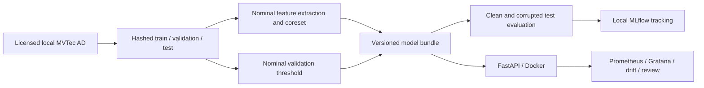

# ReliableVision

Industrial visual anomaly detection engineering project. Milestones 1 and 2 implement
the model/evaluation pipeline and CPU inference API with Docker packaging.
Milestone 3 adds local monitoring dashboards, fixed-reference input drift and
persistent human review. Final integration/documentation is Milestone 4.
This repository has no production deployment evidence.

## Quick start (PowerShell)

```powershell
python -m venv .venv
.\.venv\Scripts\python -m pip install -e '.[dev]'
.\.venv\Scripts\python -m reliablevision.cli --config configs/smoke.toml
.\.venv\Scripts\python -m pytest -q
.\.venv\Scripts\ruff check .
```

Smoke mode is CPU-only, synthetic and weight-free. It exercises the pipeline,
artifact reload, metrics, corruption conditions and local MLflow logging. Its
scores say nothing about industrial detection performance. Outputs are deliberately
not overwritten; use a fresh `output` directory in the TOML for each run.

`requirements-lock.txt` records the validated Windows/Python 3.13 environment.
For that environment, install it first with `pip install -r requirements-lock.txt`,
then install this package using `pip install -e . --no-deps`. Other supported Python
versions and platforms need their own validated dependency resolution.

## MVTec AD experiment

Obtain the original MVTec AD dataset from [MVTec](https://www.mvtec.com/research-teaching/datasets/mvtec-ad).
Its CC BY-NC-SA 4.0 license requires attribution, noncommercial use and share-alike;
review the license for your intended use, including derived artifacts. Data is not
bundled or automatically downloaded. Keep data and weights out of Git.

Expected layout: `data/mvtec_ad/bottle/train/good/*.png`,
`bottle/test/{good,defect}/*.png`, and
`bottle/ground_truth/defect/*_mask.png`. Configure a category and run:

```powershell
.\.venv\Scripts\python -m reliablevision.cli --config configs/mvtec.toml
```

Full mode uses torchvision ImageNet Wide ResNet50-2 V1 weights (downloaded on the
first run) and CUDA if available. Set `TORCH_HOME` inside this workspace before
the run; the CLI also supplies a workspace-local default. CUDA reproducibility
may require `CUBLAS_WORKSPACE_CONFIG=:4096:8` before launching Python.
The validation holdout comes exclusively from nominal training images. Thresholds
use its configured upper quantile; a small holdout does not establish an operational
false-positive guarantee. Final test data is used only for evaluation. Repeated
test-guided hyperparameter selection would invalidate this protocol.

Artifacts: `model.pt` (schema, weights, bank, threshold and metadata), `splits.json`
(image identities and SHA-256), `metadata.json`, `metrics.json`, environment freeze
and MLflow run ID and registry version. Only load trusted artifacts. Training and evaluation never
interpret raw distances as probabilities. MLflow registers run bundles as model
versions in separate synthetic and real-data namespaces. These are custom bundles,
not pyfunc models; promotion and serving lifecycle will be added in Milestone 2.

## Baseline and metrics

Following [PatchCore, Roth et al., CVPR 2022](https://openaccess.thecvf.com/content/CVPR2022/html/Roth_Towards_Total_Recall_in_Industrial_Anomaly_Detection_CVPR_2022_paper.html),
frozen layer2/layer3 features receive local 3x3 pooling and spatial alignment.
A seeded bounded priority reservoir limits candidate patches, followed by exact
greedy k-center selection in feature space. Chunked Euclidean nearest-neighbor
distances generate bilinearly resized anomaly maps. The image score is maximum
patch distance. This baseline omits the paper's image-score reweighting, embedding
projection and Gaussian map smoothing; no claim of paper-level reproduction is made.
The reservoir and memory limits affect accuracy and speed. Input images and masks
are resized to a square; fine defects may disappear at low resolution.

Reports contain image AUROC, image average precision, pixel AUROC and AUPRO up to
FPR 0.30. AUPRO gives equal weight to each 8-connected defect region, sweeps exact
score ranks and linearly interpolates the boundary. It is normalized by 0.30;
one-class/undefined metrics are JSON null. Pixel AUROC pools pixels across images.
Three severities each of Gaussian noise (sigma .03/.06/.09), Gaussian blur (radius
1/2/3) and brighter illumination (gain 1.2/1.4/1.6) are evaluated without refitting.
Masks remain unchanged. These are project-defined stress tests, not a standardized
corruption benchmark or evidence of production robustness.

## Architecture and roadmap



See [PLAN.md](PLAN.md), [LEARNING.md](LEARNING.md) and milestone reports under `docs/`.

## Real-data checkpoint

The [bottle validation report](docs/BOTTLE_VALIDATION.md) records the first real
MVTec AD CPU experiment: complete clean/corruption metrics, data/threshold audit,
localization examples, actual latency and process memory, paper deviations and
limitations. Numeric evidence is committed; licensed images and model artifacts
stay local. This is one-category validation, not a production-readiness claim.

## Serve an existing model bundle

See [the serving guide](docs/SERVING.md) for the complete API contract, Docker
instructions, concurrency limits, reproducibility and latency measurement.

```powershell
.\.venv\Scripts\python -m pip install -e '.[serve,dev]'
.\.venv\Scripts\python -m uvicorn reliablevision.serving.asgi:app --workers 1 --no-access-log
# Or, after generating artifacts/smoke with the Milestone 1 command:
# Build once per bundle; skip if its approved reference already exists:
.\.venv\Scripts\python scripts/build_drift_reference.py --artifact artifacts/smoke/model.pt
docker compose up --build -d --wait
```

The API loads that bundle's `model.pt`; no training or weight download occurs at
startup. `/predict` accepts a raw PNG/JPEG body. `/health`, `/model-info` and
`/metrics` provide readiness, model identity and Prometheus exposition. Responses
include the model SHA-256, optional registry version, raw score and resized anomaly
map. Synthetic model responses are explicitly marked.

Compose now enables monitoring and requires an approved `drift-reference.json`
beside the mounted artifact. Generate it once with
`python scripts/build_drift_reference.py --artifact artifacts/smoke/model.pt`
before the Compose command. See [MONITORING.md](docs/MONITORING.md) for the local
Prometheus/Grafana stack, explicitly simulated traffic and review workflow.
