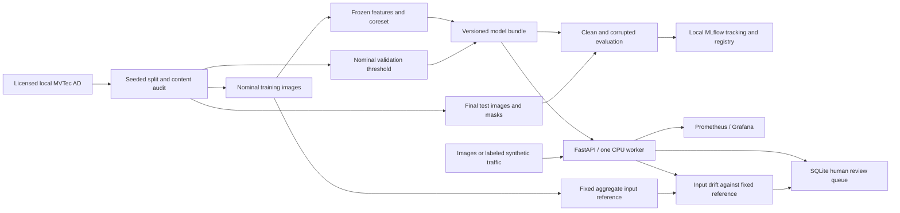

# ReliableVision

**An end-to-end visual anomaly detection portfolio project: from nominal-image
training to versioned inference, monitoring and human review.**

Python · PyTorch · FastAPI · MLflow · Docker Compose · Prometheus · Grafana

Industrial inspection often has many acceptable products and few examples of
defects. ReliableVision fits a PatchCore-based detector on nominal images, scores
unusual images and produces pixel-level anomaly maps. The engineering work covers
leakage controls, reproducible experiments, artifact parity, service validation,
observability and human review. PatchCore is an existing method, not a novel contribution.

**Locally validated; not production-tested.** The real experiment covers only
MVTec AD **bottle**. Synthetic smoke tests and simulated traffic are separate demonstrations.

## What is implemented

| Concern | Implementation |
| --- | --- |
| Model | Frozen ImageNet Wide ResNet50-2 patch features, bounded candidate reservoir, greedy coreset, nearest-neighbor scores/maps. |
| Data integrity | Seeded nominal train/validation split, hash manifests, duplicate checks, validation-only image thresholds. |
| Evaluation | Image AUROC/AP, pixel AUROC, normalized AUPRO ≤ 0.30 FPR; nine fixed corruption conditions. |
| Reproducibility | TOML, seeds, data/artifact hashes, environment snapshots, local MLflow tracking/model versions. |
| Serving | CPU FastAPI, actual artifact loader, shared preprocessing, bounded image validation, structured errors/logs. |
| Operations | Traffic-labeled Prometheus metrics, Grafana dashboard, fixed-reference input drift, persistent SQLite review decisions. |
| Delivery | Hash-locked CPU serving wheels, digest-pinned containers, tests, GitHub Actions lint/test/Docker workflow. |

## Architecture



Training, evaluation and serving are separate modules. The API loads the actual
`model.pt`; it does not implement another detector. Traffic and review decisions
never automatically refit the model, reference or thresholds.

## Measured results: real MVTec AD bottle

One fixed CPU experiment: **167 nominal train / 42 nominal validation / 83 test**
images (20 good, 63 defective). Source images are **900×900**; evaluated inputs,
maps and masks are **224×224**. No final-test threshold tuning.

| Condition | Image AUROC | Image AP | Pixel AUROC | AUPRO ≤ 0.30 |
| --- | ---: | ---: | ---: | ---: |
| Clean | 1.0000 | 1.0000 | 0.9849 | 0.9337 |
| Noise, severity 3 | 0.9254 | 0.9794 | 0.9316 | 0.7458 |
| Blur, severity 3 | 0.9810 | 0.9940 | 0.9525 | 0.8478 |

The nominal-validation threshold **1.92355** produced TP=63, TN=20, FP=0, FN=0
on this clean test split. Zero observed errors on 83 images is not a deployment
guarantee. High image-level performance does not imply sharp defect boundaries.

Measured on an AMD Ryzen 5 7530U, two CPU threads, sequential inference:

| Operating point | Forward p50 / p95 | Peak process RSS |
| --- | ---: | ---: |
| 224×224, validated quality | 419 / 472 ms | 659 MiB |
| Native 900×900, resource experiment only | 6.30 / 6.42 s | 835 MiB |

Native timing reused the 224-trained bank; quality at that resolution was not
validated. Complete fitting/evaluation/tracking took **858.93 s**, peaking at
**2.58 GiB**. These timings exclude HTTP serialization/network work and are not
production SLOs. See the [full real-data report](docs/BOTTLE_VALIDATION.md) and
[numeric evidence](docs/benchmarks/mvtec-bottle-checkpoint.json).

## Run the CPU smoke workflow

Recommended: **Python 3.13.15**. The package declares Python 3.11+; other versions
need compatible dependency resolution and verification. No GPU, MVTec data or
pretrained weights are needed for smoke tests. Initial dependency/image installation
requires internet access.

Linux amd64 / Python 3.13:

```bash
python3.13 -m venv .venv
. .venv/bin/activate
python -m pip install --require-hashes -r requirements/serve.lock
python -m pip install --no-build-isolation -c requirements-lock.txt -e '.[serve,dev,validation]'
python -m pytest -q
ruff check .
ruff format --check .
python -m reliablevision.cli --config configs/smoke.toml
python scripts/build_drift_reference.py --artifact artifacts/smoke/model.pt
```

For **Windows PowerShell**, use [REPRODUCIBILITY.md](docs/REPRODUCIBILITY.md).
The Windows version lock and Linux serving wheel-hash lock serve different
purposes; do not interchange their wheel hashes. Outputs and approved references
are never silently overwritten. Repeat with a fresh output/tracking database:

```bash
python -m reliablevision.cli --config configs/smoke.toml \
  --output artifacts/another-smoke --tracking-uri sqlite:///artifacts/another-mlflow.db
```

### Local service, dashboard and review demo

With Docker's Linux engine running and the smoke bundle ready:

```bash
docker compose config --quiet
docker compose build api
docker run --rm --user 0 --mount "type=bind,source=$PWD,target=/workspace" \
  --entrypoint python reliablevision:local /workspace/scripts/prepare_state.py
docker compose up -d --wait --wait-timeout 120
python scripts/check_serving.py
python scripts/simulate_traffic.py
python scripts/check_monitoring.py
python scripts/check_monitoring.py --queries-only
docker compose restart api
docker compose up -d --wait
python scripts/check_monitoring.py --after-restart
docker compose down
```

| Interface | Local URL / endpoint |
| --- | --- |
| Prediction | `POST http://127.0.0.1:8000/predict`, raw PNG/JPEG body |
| Readiness / identity | `/health`, `/model-info` |
| Metrics / review | `/metrics`, `/reviews`, `PATCH /reviews/{id}` |
| API schema | `http://127.0.0.1:8000/docs` |
| Prometheus alerts | `http://127.0.0.1:9090/alerts` |
| Grafana dashboard | `http://127.0.0.1:3000/d/reliablevision` |

The simulator labels every request. The original 80-image demo produced two
shifted-window alerts and a review decision that survived restart. It also produced
20 baseline score flags without input drift—an observed toy-model limitation,
not an industrial false-positive estimate. Grafana is local anonymous Viewer;
review APIs have no authentication. Do not expose this control plane publicly.

## Reproduce the real experiment

Obtain original MVTec AD from [MVTec](https://www.mvtec.com/research-teaching/datasets/mvtec-ad).
Its **CC BY-NC-SA 4.0** terms include a noncommercial restriction. No dataset is
bundled, automatically downloaded or redistributed. Images, weights and derived
figures stay out of Git. See [dataset attribution](docs/DATA_LICENSE.md).

Place bottle at `data/mvtec_ad/bottle/{train,test,ground_truth}`, retain all images
and masks, and follow [the real-data procedure](docs/REPRODUCIBILITY.md#real-mvtec-ad-bottle).
Full runs need the official pretrained V1 weights (cached inside this workspace),
RAM and time. CUDA is used for fitting/evaluation if available. Artifact loading
and serving do not download weights.

## Limitations that matter

- One category and one seed do not reproduce the full MVTec benchmark. Exact
  hashes cannot rule out near-duplicate/session leakage.
- Paper image-score reweighting, projected coreset acceleration and Gaussian map
  smoothing are omitted; embedding/preprocessing also differ. Reservoir limits
  alter the effective coreset fraction. This is not an exact paper reproduction.
- Scores are **raw distances, not probabilities**. The small validation quantile
  has no guaranteed operational false-positive rate. Pixel metrics use resized masks.
- Noise weakens localization. Stress tests cover post-resize corruptions and
  brighter-only illumination, not all production shifts.
- Brightness drift is not accuracy degradation; semantic failures may be invisible.
  Review labels are selection-biased and need external context.
- One CPU worker, SQLite, lost partial windows, activity-based retention and
  fail-closed persistence limit scale/availability. There is no TLS, authentication,
  external alert delivery or production operational evidence.

## Project guide

- [Setup, artifacts and reproducibility](docs/REPRODUCIBILITY.md)
- [Serving and concurrency](docs/SERVING.md)
- [Monitoring, privacy and review](docs/MONITORING.md)
- [Learning guide and interview answers](LEARNING.md)
- [CV / LinkedIn / interview summary](docs/PORTFOLIO.md)
- [Final completion report](docs/FINAL_REPORT.md)
- [Milestone reports](docs/MILESTONE_1.md): [2](docs/MILESTONE_2.md), [3](docs/MILESTONE_3.md), [4](docs/MILESTONE_4.md)

Reference: [Roth et al., Towards Total Recall in Industrial Anomaly Detection,
CVPR 2022](https://arxiv.org/html/2106.08265v2).
