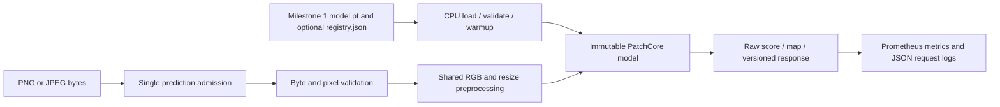

# CPU inference service

## Run locally

Use Python 3.11+; the validated host environment is Windows/Python 3.13.
Install `pip install -e '.[serve,dev]'` in the workspace virtual environment.
Generate a smoke artifact with the existing Milestone 1 CLI if necessary, or use
an existing licensed-data experiment's bundle. Do not overwrite previous runs.

```powershell
$env:RV_MODEL_PATH = 'artifacts/smoke/model.pt'
.\.venv\Scripts\python -m uvicorn reliablevision.serving.asgi:app --host 127.0.0.1 --port 8000 --workers 1 --no-access-log
```

`configs/serve.toml` controls upload/pixel limits and PyTorch intra-op threads.
`RV_SERVE_CONFIG` selects another TOML. `RV_MODEL_PATH` overrides its artifact path.
Paths must resolve under the working directory (workspace, or `/app` in Docker).
Serving always loads CPU weights with `PatchCore.load`, never trains, and never
downloads pretrained weights. It loads once during FastAPI lifespan, validates
metadata/thresholds and performs a warmup before readiness. Missing, corrupt or
incompatible artifacts cause startup failure; no synthetic fallback is created.



Image preprocessing is shared with dataset loading: RGB conversion, explicit PIL
bicubic square resize to the artifact's image size, float32 division by 255, CHW
tensor. ImageNet normalization belongs to the loaded full feature extractor.
EXIF orientation is not automatically changed, matching training behavior. The
API does not crop, normalize maps or fit thresholds. Grayscale/alpha inputs use
PIL's RGB conversion, including dropping alpha rather than compositing it.

## Endpoint contract

| Endpoint | Behavior |
| --- | --- |
| `GET /health` | Ready only after artifact validation and warmup; includes model SHA-256. Startup failure prevents listening. |
| `GET /model-info` | Algorithm, immutable artifact hash, optional MLflow name/version, category, data mode, threshold, image size, CPU/thread settings and concurrency limit. |
| `POST /predict` | Raw `image/png` or `image/jpeg` bytes; one single-frame image. Returns score, image decision, threshold, raw anomaly map, inference seconds, request ID and model information. |
| `GET /metrics` | Prometheus text exposition from a per-app registry; no redirect. |

Interactive schema: `/docs`; machine schema: `/openapi.json`.

For an image in the workspace:

```powershell
curl.exe -H 'Content-Type: image/png' --data-binary '@artifacts/example.png' http://127.0.0.1:8000/predict
```

`score` is a nearest-neighbor distance, **not a probability**. `is_anomaly` uses
strict `score > threshold`. The threshold comes from nominal validation in the
saved bundle. `anomaly_map` is a nested row/column float array at `map_shape`, in
`resized_model_input` coordinates. It is not an original-resolution mask; a caller
must deliberately map coordinates back to its image. There is no pixel mask
calibration or confidence claim. `synthetic: true` and `data_mode: synthetic_smoke`
identify smoke fixtures, including when served through Docker.

`model_version` is the SHA-256 of the actual loaded artifact. `registry_name` and
`registry_version` come from optional sibling `registry.json`; absent sidecars
produce null values. Sidecar claims are local provenance, not cryptographic proof
of registry membership. Keep bundle files together and immutable during serving.
Deploy another bundle by stopping/recreating the service; hot reload is unsupported.
The custom bundle is not an MLflow pyfunc model and requires this artifact loader.

Errors use `{"error":{"code":"...","message":"..."},"request_id":"..."}`
and the same ID appears in `X-Request-ID`. IDs are server-generated. Typical status
codes: 400 invalid length/disconnected upload, 413 byte or decoded-pixel limit,
415 unsupported or mismatched content type, 422 empty/corrupt/multiframe image,
503 occupied prediction capacity (`Retry-After: 1`), 500 sanitized internal error.
Unexpected exceptions never expose payloads or filesystem paths to clients.

The 5 MiB default byte limit is enforced while consuming the request stream even
without a Content-Length header. Header dimensions are checked before pixel loading
against 16 million pixels. Pillow's decompression safeguards also remain enabled.
These limits apply to the application; a server may already buffer an incoming
ASGI chunk. Use upstream connection/body timeouts for untrusted networks.

## Concurrency, timing and logs

Run exactly one Uvicorn worker. Each process owns one immutable model, one
admission lock and one Prometheus registry. One prediction is admitted before body
reading; another receives 503 instead of waiting in an application queue. Decode
and inference execute in a worker thread so health and metrics can respond. A
second lock protects direct runtime calls. There is no batching, model mutation or
background fitting. Request cancellation does not intentionally abandon an active
inference thread. Clients should use bounded retries and backoff.

`torch_threads=2` sets PyTorch intra-op threads process-wide. Do not run multiple
apps with different thread settings in one process. Multiple Uvicorn workers would
duplicate model memory, admit one prediction per worker and expose incomplete
per-process metrics without multiprocess aggregation. Horizontal scaling and
Prometheus multiprocess mode are outside this milestone.

`inference_seconds` and `rv_inference_seconds` measure model forward only; input
decoding, map conversion and response serialization are excluded. The
`rv_http_request_seconds` histogram measures application request handling through
response creation; socket transmission is excluded. `rv_http_requests_total` has
bounded route/method/status labels and provides throughput and failure counts.
`rv_predictions_active` measures admitted requests through prediction completion;
`rv_anomaly_score` records raw-distance distributions. No image content, request
IDs or filenames become metric labels. Metric scrapes themselves count as requests
and appear on the following scrape. Dashboards and scraping services arrive in
Milestone 3.

Application request and model-load logs are JSON with UTC timestamps. Each request
records route, status, request ID and elapsed time; payloads and arbitrary URL paths
are omitted. Uvicorn's lifecycle logs retain its standard format. No authentication,
TLS, per-client rate limit or upload deadline is implemented; Compose binds to
loopback. An external deployment needs those controls and operational validation.

## Docker Compose

Docker Desktop/Linux engine must be running. From the workspace:

```powershell
docker compose config --quiet
docker compose build api
docker compose up -d --wait
curl.exe http://127.0.0.1:8000/health
docker compose logs api
docker compose down
```

Default bind mount is `./artifacts/smoke` to `/app/models`, read-only. Set
`RV_MODEL_DIR` to another bundle directory before `compose up`. The source must
exist and contain `model.pt`; it is never downloaded or baked into the image.
For full pretrained models, validate and adjust the two-CPU/2-GiB limits using
actual memory and latency measurements. Those settings are not full-model sizing
guarantees. The image runs as UID/GID 10001, drops capabilities, and uses a read-only
root with a bounded temporary filesystem. Healthcheck warmup allowance is 60 seconds.

The image targets **Linux amd64 / CPython 3.13**, using an official image manifest
pinned by SHA-256. `requirements/serve.lock` pins every serving dependency and
wheel hash, including CPU-only torch/torchvision. The build uses `--require-hashes`,
binary wheels and `pip check`, with no mutable apt repository or source builds.
Training/MLflow dependencies are excluded from the serving runtime. The build
context excludes data, artifacts, secrets and the virtual environment. This fixes
runtime inputs; byte-identical OCI output across different Docker versions or
build timestamps is not claimed. Registry availability is still needed to build.

To update the Linux lock intentionally, use a fresh/empty
`artifacts/docker-wheels` directory and run the resolver in the same pinned base:

```powershell
docker run --rm --platform linux/amd64 --mount "type=bind,source=${PWD},target=/workspace" --workdir /workspace python:3.13.15-slim-bookworm@sha256:3e2de9c40ca4e3d73240059f9d48baff27908f10293e985a2f382a0378e6df4a python scripts/lock_serving.py
```

Review the resulting lock and rerun build/runtime tests. `serve.in` pins direct
dependencies; regeneration resolves transitive versions anew. Windows development
has a separate `requirements-lock.txt`. Linux wheel hashes are intentionally not
portable to other Python versions/architectures. An update to the base, PyTorch or
Pillow needs artifact compatibility and preprocessing parity verification.

## Measure local HTTP latency

With the service running:

```powershell
.\.venv\Scripts\python scripts/check_serving.py
.\.venv\Scripts\python scripts/benchmark_api.py --requests 100 --warmup 10
```

`check_serving.py` checks the four endpoints and compares score/map output with
direct inference on the local artifact (use `--artifact` for another bundle).
It stores actual parity evidence under `artifacts/docker-check.json`.

This creates seeded synthetic PNG input and saves raw samples, image size, artifact
identity, thread settings, warmup/sample counts, p50/p95/mean HTTP and forward times
and observed sequential request rate. HTTP time includes client-side parsing and
the anomaly-map response. Concurrency is one; this is not a saturation benchmark,
SLO, full-model performance estimate or production traffic. See the milestone
report for actual measured results and the environment used.

## References

The lifespan pattern follows [FastAPI's lifespan documentation](https://fastapi.tiangolo.com/advanced/events/).
Streaming input uses the [Starlette request interface](https://starlette.dev/requests/).
Metrics use the official [Prometheus Python client](https://prometheus.github.io/client_python/).
